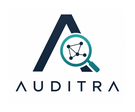

  

<h1 align="center">Auditra</h1>

  <strong>Sistem Prioritas Audit Pengadaan Publik berbasis Knowledge Graph &amp; Analisis Jaringan</strong> 
  Mengolah ~3 juta paket SIRUP LKPP untuk membantu auditor fokus pada yang paling mendesak — bukan menebak.

  <a href="https://github.com/danisharizka/auditra">GitHub</a> ·
  <a href="https://sirup.lkpp.go.id/">SIRUP LKPP</a> ·
  Tim <code>SD2026020000253</code> · TA 2026

  
  
  
  

---
