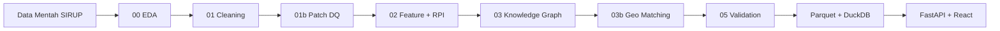

# Auditra — Data Science Lifecycle

Dokumen ini memetakan implementasi proyek Auditra terhadap **teori sains data** dari tingkat dasar hingga tingkat tinggi, dari data mentah hingga siap deploy.

---

## Ringkasan Maturitas

| Tahap DS | Status | Implementasi |
|----------|--------|--------------|
| **Problem framing** | ✅ | Audit prioritas pengadaan publik berbasis SIRUP + KG |
| **EDA** | ✅ | `00_eda.py` → `output/reports/eda_*` |
| **Data collection** | ✅ | `data/year-2026_merged.csv` (SIRUP) |
| **Preprocessing / cleaning** | ✅ | `01_cleaning.py`, `01b_patch_lembaga_provinsi.py` |
| **Feature engineering** | ✅ | 7 sinyal risiko di `02_scoring.py` |
| **Anomaly detection** | ✅ | Z-score pagu (S2), IQR outlier di EDA |
| **NLP / similarity** | ✅ | TF-IDF + cosine similarity (S3 fragmentasi) |
| **Graph analytics** | ✅ | Knowledge Graph, centrality, community detection |
| **Geo-spatial join** | ✅ | `03b_geo_matching.py` |
| **Model scoring** | ✅ | Rule-based weighted RPI (bukan ML supervised — by design) |
| **Validation / QA** | ✅ | `05_validate.py`, `pipeline/validate.py` |
| **Visualization** | ✅ | React dashboard + EDA Plotly HTML |
| **Serving / API** | ✅ | FastAPI + DuckDB materialized cache |
| **Deployment** | ⚠️ | Manual run; Docker opsional (lihat bawah) |
| **Monitoring / MLOps** | ❌ | Belum (tidak ada model ML yang perlu retrain) |
| **Supervised ML** | ➖ | Tidak dipakai — domain expert rules + KG |

**Kesimpulan:** Pipeline sudah mencakup **dasar → menengah → lanjut** untuk use case **rule-based risk scoring + knowledge graph**. Yang sebelumnya kurang (EDA formal, validasi terstruktur, orchestrator) sudah dilengkapi.

---

## Alur End-to-End

---

